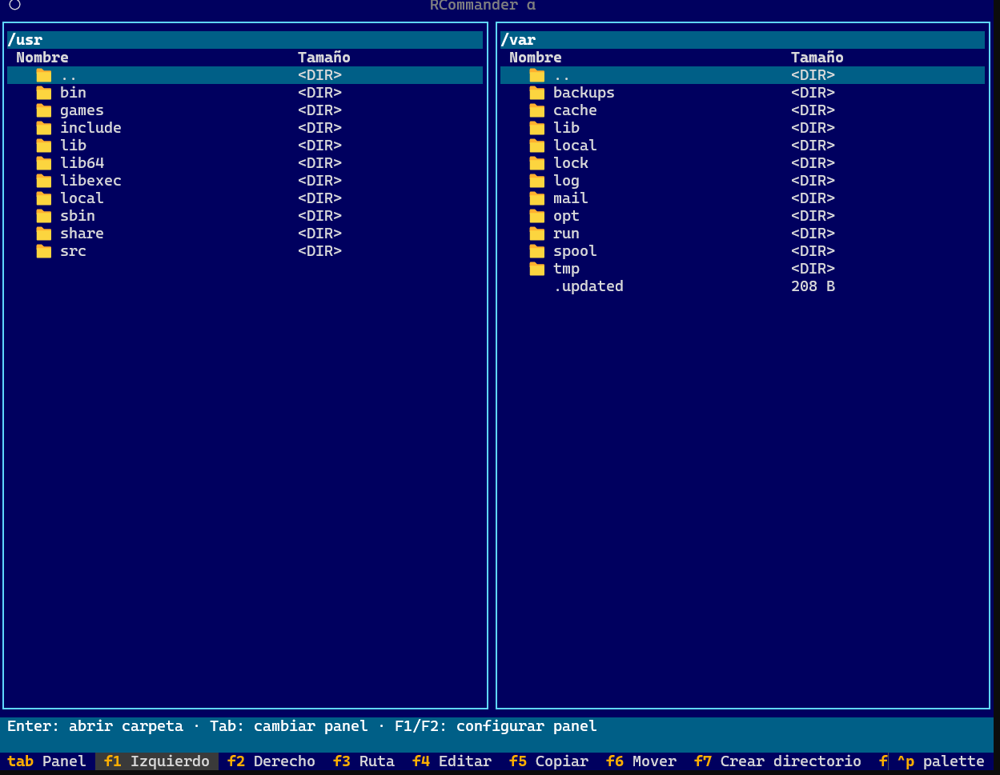

# RCommander alpha

[Español](READMEsp.md)

A two-panel terminal file manager for Debian/WSL, inspired by Midnight Commander. It supports local and remote SSH navigation, as well as copying files with rsync, SCP, or direct local copying.



## Run

From the project directory in Debian/WSL:

```bash
python3 -m venv .venv
source .venv/bin/activate
python -m pip install -r requirements.txt
python app.py
```

The application requires Python, `rsync` and the OpenSSH client. Install `sshpass` to authenticate with a password, and Vim to edit local files:

```bash
sudo apt install python3 python3-venv python3-pip rsync openssh-client sshpass vim
```

## Keyboard shortcuts

| Key | Action |
|---|---|
| Arrow keys / Enter | Select and open a directory |
| Tab | Switch panels |
| Insert | Mark or unmark the current item and move down |
| F1 / F2 | Configure the left / right panel as local or SSH |
| F3 | Go to a local or remote path |
| F4 | Edit the selected file with Vim, locally or over SSH |
| F5 | Copy to the other panel using rsync, SCP or direct local copying |
| F6 | Move to the other panel, local panels only |
| F7 | Create a directory in the active panel, local or remote |
| F8 | Delete the selected files or directories after confirmation |
| F9 | Refresh both panels |
| F10 | Quit |
| Ctrl+S | Open an SSH console; use `exit` to return |
| Ctrl+X | Cancel an SCP or rsync transfer |

Use the arrow keys or Tab to move between dialog buttons and Enter to select one. F5, F6 and F8 operate on all marked items in the active panel, or on the current row if no items are marked. Marked items are shown with `*`. Marks remain when a panel is refreshed and are cleared when changing directories or after a successful operation. After an error or cancellation, marks remain for items still present in the panel.

F8 deletes directories recursively, including their contents. Symbolic links are removed without deleting the directories they point to. Copies may overwrite existing files. Rsync uses `-a` and does not delete extra files from the destination. Vim must be installed on the machine containing the file being edited; use `:wq` to save and quit, or `:q!` to discard changes.

File sizes use binary units (KiB, MiB, GiB). Rsync displays overall progress; SCP displays progress for the current file, so it may restart for each file in a directory. SCP between two local paths may not report progress. Direct copying does not show a percentage and cannot be cancelled with Ctrl+X. Cancelling SCP or rsync may leave partial or already copied files at the destination.

## SSH

Use F1 or F2, select **Remote SSH**, and enter `user@server` or an alias from `~/.ssh/config` (which can specify a custom port), followed by the password. The panel opens the remote starting directory (`.`). Leave the password empty to use an SSH key or agent. Passwords are kept in memory while the panel is connected and passed to `sshpass` through its environment, without being saved to disk. To return to a local panel, press F1 or F2 and select **Local**.

Ctrl+S opens an interactive SSH console. If the active panel is remote, it uses that connection and starts in the panel's current directory; the panel is refreshed on exit. If the active panel is local, it asks for a server and password and opens an independent console. Type `exit` or press Ctrl+D to return to the application.

Unknown host keys are automatically accepted on first connection; SSH rejects a changed known host key. To verify a fingerprint beforehand, connect with `ssh user@server`. Remote navigation requires Python 3 on the server; rsync must also be installed at both ends to use it. This alpha supports only one remote endpoint per transfer.

### License

GNU General Public License v3.0 or later.
